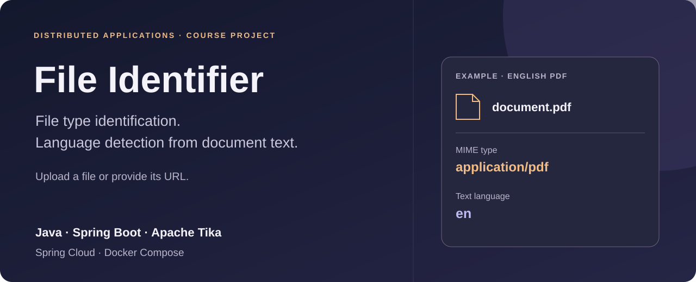
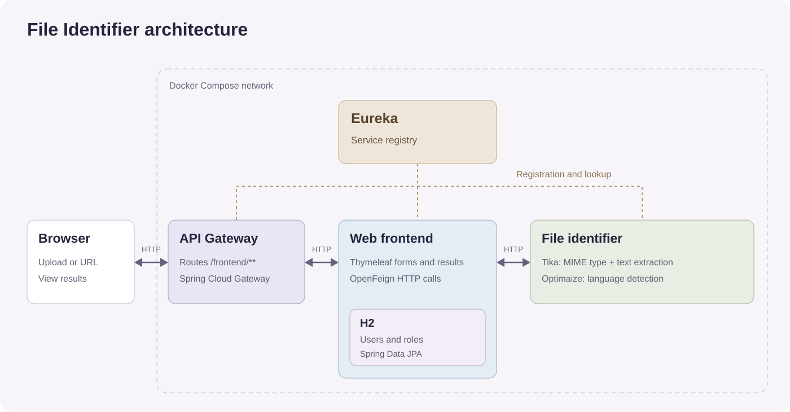

# File Identifier

[Português](README.pt-PT.md)

File Identifier is a Java/Spring Boot web application that identifies a file's MIME type and detects the language of its text. Users upload a file or provide a URL, then see its name, type and detected language.

Developed in a two-person team for the **Distributed Applications** course.

## File analysis

Apache Tika identifies the MIME type from the file content and extracts text from documents. Optimaize uses that text to estimate the language. Language detection needs enough readable text; a file without text may have a detectable type but no useful language result.

## Architecture

The gateway routes web requests to the Thymeleaf frontend. The frontend calls the identifier service through OpenFeign and displays the results. Eureka provides service registration and lookup. Docker Compose defines the services and their shared network.

The frontend stores user accounts and roles in an embedded H2 database through Spring Data JPA.

## Technologies

| Area | Stack |
| --- | --- |
| Services | Java 19, Spring Boot 3, Spring Web |
| Routing and communication | Spring Cloud Gateway, Eureka, OpenFeign |
| File processing | Apache Tika 2.6, Optimaize Language Detector |
| Web interface | Thymeleaf, HTML, CSS, JavaScript |
| Users and roles | Spring Security, BCrypt, Spring Data JPA, H2 |
| Build and containers | Maven, Docker, Docker Compose |

## My contribution

I co-developed the web frontend, file-analysis endpoints, service integration and Docker Compose setup.

Source code is private.
